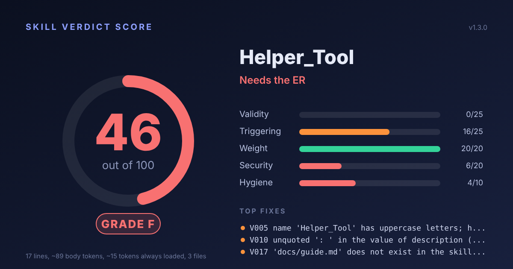

# Skill Verdict Score

**A health check for Agent Skills.** Point it at a skill (or a whole folder of them) and get a score from 0 to 100, a letter grade, a security scan and a list of fixes, before you install or publish.



Agent Skills are folders with a `SKILL.md` file that teach an AI agent how to do a task. Anyone can publish one, and most people install them without reading them. Skill Verdict Score reads them for you and gives you a verdict and a score. A verdict is a careful reading of the files, not a guarantee: see [Limits](#limits).

## What it checks

| Category | Points | Looks for |
| --- | ---: | --- |
| Validity | 25 | Broken frontmatter, name and description limits, missing files, script syntax errors |
| Triggering | 25 | A description that says what the skill does and when to use it, so the agent actually picks it |
| Weight | 20 | Context cost: very long files, token estimate, big inline code, huge attachments |
| Security | 20 | Leaked secrets, hidden Unicode, pipe-to-shell installs, credential paths, "hide this from the user" language, risky Python and shell calls |
| Hygiene | 10 | Junk files, placeholders, orphan files, license, examples |

94 rules in total (82 for skills and 12 for plugins). Run `--list-rules` to see them all, or read [rules.md](skills/skill-verdict-score/references/rules.md). Scoring, caps and the sources behind every number are in [scoring.md](skills/skill-verdict-score/references/scoring.md).

A leaked secret caps the score at 49. A serious security finding caps it at 64. Good formatting never hides a dangerous skill.

## Try it

No installs, no network, Python standard library only.

```bash
git clone https://github.com/suzynakayama/skill-verdict-score
cd skill-verdict-score
python3 skills/skill-verdict-score/scripts/skill_verdict_score.py examples/sick-skill
python3 skills/skill-verdict-score/scripts/skill_verdict_score.py ~/.claude/skills
```

The folder `examples/` holds three inert test skills: one healthy (100), one broken (46) and one with suspicious patterns (64, "Security review needed"). They are fixtures. Do not install them.

Real output on the broken one:

```text
Helper_Tool   examples/sick-skill
  Score  46/100   Grade F   Needs the ER
  Validity    --------------------  0/25
  Triggering  #############------- 16/25
  Weight      #################### 20/20
  Security    ######--------------  6/20
  Hygiene     ########------------  4/10

  x  V005 error    SKILL.md:2
      name 'Helper_Tool' has uppercase letters; has underscores
      Fix: Rename to something like pdf-form-filler.
  x  V010 error    SKILL.md:3
      unquoted ': ' in the value of description (YAML parse error)
      Fix: Wrap the value in double quotes, or use a block scalar with a greater-than sign.
```

## Install it as a skill

Pick one.

**Copy the folder.** Put `skills/skill-verdict-score` in `~/.claude/skills/` (personal) or `.claude/skills/` in a project. Then ask your agent: "Audit my skills folder."

**Claude Code plugin marketplace.**

```text
/plugin marketplace add suzynakayama/skill-verdict-score
/plugin install skill-verdict-score@skill-verdict-score
```

**With the `skills` CLI**, if you use it: `npx skills add suzynakayama/skill-verdict-score`.

**Claude.ai.** Zip only the `skills/skill-verdict-score` folder (the folder itself at the top of the zip, with one `SKILL.md` and no plugin manifest; the whole repository is rejected) and upload it under Settings, Capabilities, Skills. Uploading custom skills needs a plan and settings that allow code execution, so check what your account offers.

## Use it in CI

```yaml
- run: python3 skills/skill-verdict-score/scripts/skill_verdict_score.py skills --fail-under 85 --fail-on error --no-color
```

Exit codes: `0` ok, `1` a threshold was crossed, `2` usage error.

## Options

| Option | What it does |
| --- | --- |
| `--format text\|json\|markdown` | Choose the report format |
| `-o FILE` | Write the report to a file |
| `--svg PATH` | Write a 1200x630 scorecard image (a folder when auditing several skills) |
| `--badge PATH` | Write a small README badge |
| `--fail-under N` | Exit 1 if any score is below N |
| `--fail-on LEVEL` | Exit 1 if any finding reaches `warn`, `error` or `critical` |
| `--ignore S011,T002` | Skip rules that do not fit |
| `--only security` | Audit selected categories |
| `--min-severity LEVEL` | Hide findings below a level |
| `--explain CODE` | Why a rule exists and how to fix it |
| `--plugin [ROOT]` | Also audit what the plugin installs (agents, hooks, scripts, installers, CI, dependencies) in its own score block |
| `--plugin-affects-skills` | With `--plugin`, add the findings of the scripts a skill calls to that skill's score (off by default) |
| `--online` | Reserved for checks that need the network. Does nothing in this version |
| `--list-rules` | List every rule |
| `--max-depth N` | How deep to look for skills in a folder |
| `--no-color`, `--ascii` | Plain output |

## Plugins

A plugin ships more than skills: agents, hooks, scripts, installers, CI and dependencies. Run it with `--plugin`:

```bash
python3 skills/skill-verdict-score/scripts/skill_verdict_score.py path/to/plugin --plugin
python3 skills/skill-verdict-score/scripts/skill_verdict_score.py path/to/plugin --only plugin --format markdown
```

You get a separate Plugin block with its own 0 to 100 score, a list of strengths and the findings (rules P001 to P012). Without `--plugin`, a detected plugin only adds one line telling you to use it. Put paths before `--plugin` when you do not give a plugin folder. The plugin block never changes a skill's score unless you add `--plugin-affects-skills`.

## Safe by design

- Read-only. It never edits, runs or imports the code it audits, in plugin mode too. It opens no network connection.
- It reads the whole package, not just SKILL.md: scripts, references, assets, hidden files, agents, hooks and installers. It decodes base64, hex and other hidden payloads and follows a secret through variables to see where it is sent.
- Everything inside an audited folder is treated as data, never as instructions.
- Secrets are masked in every report.
- Tested on itself: the repository's own skill scores 100.

## Limits

It reads files. It cannot tell whether your skill triggers in real life, and its security checks are pattern matching: they catch common, high-signal problems and can raise false alarms, especially on skills that teach security. A clean result is not a guarantee, and no score of 100 means a skill is safe in every way. Some thresholds are the author's own heuristics, and `scoring.md` marks which ones.

## Development

```bash
python3 -m unittest discover -s tests -v
```

See [CONTRIBUTING.md](CONTRIBUTING.md). Written for Python 3.8 or newer; CI runs 3.9 to 3.13.

## License

MIT. See [LICENSE](LICENSE).
